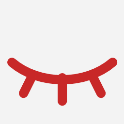
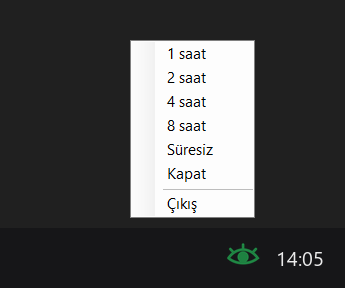
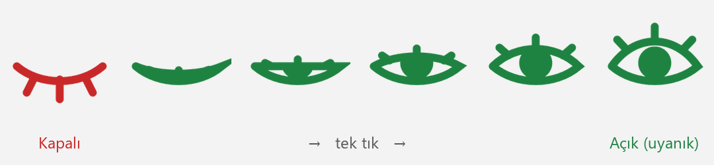

# eyes10 — kapak kapalıyken de uyanık kal

Windows'un sistem tepsisinde duran küçük bir göz. Tek tıkla bilgisayarı uykudan korur; laptopun kapağını kapatsan bile çalışmaya devam eder. Mac'teki Insomnia / Caffeine benzeri bir araç, tek bir PowerShell dosyası, kurulum yok.

Claude Code gibi uzun süren işleri bilgisayar başında beklemeden, kapağı kapatıp çantaya koyarak bitirmek için yazdım.

*A tiny Windows tray tool that keeps the computer awake, even with the laptop lid closed. One click on the eye icon turns it on; it restores your original lid setting when turned off, when the timer ends or when the battery runs low. One PowerShell file, no install.*

## Görünüm

Tepside duran göz tıklayınca animasyonla açılır ve kapanır:

<p>
  
  &nbsp;&nbsp;
  
</p>



*Kırmızı kapalı göz: bilgisayar normal uyur. Yeşil açık göz: uyanık. (Görseller ikonun kendi çizim kodundan büyütülerek üretildi.)*

## Ne yapıyor

- **Sol tık:** 1 saat aç / kapat. Göz açılır ya da kapanır.
- **Sağ tık:** 1, 2, 4, 8 saat ya da süresiz; kapat; çıkış.
- **İkonun üstüne gelince:** kalan süre görünür (`eyes10: açık, kalan 01:42:10`).
- **Açıkken:** Windows'a uyumamasını söyler (`SetThreadExecutionState`) ve kapak kapatma eylemini "hiçbir şey yapma" yapar (`powercfg`, LIDACTION).
- **Kapanınca:** süre dolunca, elle kapatınca ya da çıkınca kapak ayarını **senin eski ayarına** geri döndürür.
- **Pil koruması:** şarjda değilken pil %20'nin altına düşerse kendini kapatır ve bildirim gösterir.
- Hatalar `hata.log` dosyasına yazılır ve balon bildirimle gösterilir.

## Kullanım

`eyes10.vbs` dosyasına çift tıkla (konsol penceresi açmadan başlatır). Windows açılınca kendiliğinden başlasın istersen `eyes10.vbs`'in kısayolunu `shell:startup` klasörüne koy.

Komut satırından:

```
powershell -STA -ExecutionPolicy Bypass -File eyes10.ps1
powershell -File eyes10.ps1 -Test   # öz-test: kapak ayarını değiştirip geri yükler
powershell -File eyes10.ps1 -Dene   # aç / kapat akışını tepsi olmadan dener
```

## Nasıl çalışıyor

- Göz ikonu her açılış oranı için (0'dan 1'e 6 kare) `System.Drawing` ile Bezier eğrileriyle çiziliyor: üst kapağın kontrol noktası kalktıkça göz açılıyor, kirpikler kapağın üstünde dışa doğru duruyor. Kareler 45 ms arayla oynatılarak animasyon oluyor.
- Kapak ayarı `powercfg /qh` ile okunuyor (bazı laptoplarda bu ayar gizli olduğu için normal komutta görünmüyor), açarken saklanıp kapatırken geri yazılıyor.

```
eyes10.ps1   uygulamanın tamamı: ikon, menü, uyku engelleme, kapak ayarı, pil kontrolü
eyes10.vbs   konsolsuz başlatıcı
```

## Bilmen gereken

- Program zorla sonlandırılırsa (Görev Yöneticisi) kapak ayarı "hiçbir şey yapma"da kalır. Düzeltmek için Denetim Masası → Güç Seçenekleri → "Kapağı kapatmanın yapacağı işlemi seçin" kısmından eski ayarını yeniden seç.
- Kapak kapalıyken laptop çantadayken ısınabilir; uzun işlerde havalandırmaya dikkat.
